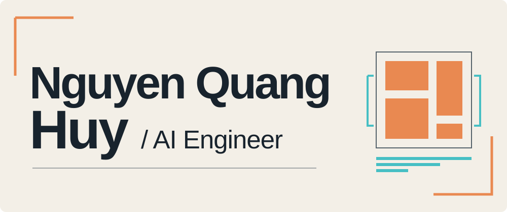

<picture>
  <source media="(prefers-color-scheme: dark)" srcset="assets/hero-dark.svg">
  <source media="(prefers-color-scheme: light)" srcset="assets/hero-light.svg">
  
</picture>

I build hands-on applied ML systems across computer vision, retrieval and RAG. My work connects model evaluation with ML systems and infrastructure, including professional work on legal-document AI.

## Research

<blockquote>
<strong>Comic Panel Extraction using U-Net++ Deep Learning Model and Line Segment Analysis</strong> 
Accepted for presentation at RIVF 2026 
Comic-panel extraction combines U-Net++ segmentation with line-segment analysis. 
<a href="https://rivf2026.org">Conference</a> · <a href="https://github.com/huyproman/comic-panel-segmentation">Paper code</a>
</blockquote>

## Selected engineering

<table width="100%">
<tr><td width="80"></td><td>
<strong>Scientific RAG</strong> 
RETRIEVAL / EVIDENCE 
Scientific-document retrieval and evidence-grounded Q&amp;A with BM25, dense and hybrid search. 
<a href="https://github.com/huyproman/scientific-grounded-rag">Repository ↗</a>
</td></tr>
</table>

<table width="100%">
<tr><td width="80"></td><td>
<strong>CAPTCHA OCR</strong> 
VISION / SEQUENCE MODELS 
Full-image sequence recognition with CNN, BiGRU, Transformer and CTC models. 
<a href="https://github.com/huyproman/captcha-ocr">Repository ↗</a>
</td></tr>
</table>

<table width="100%">
<tr><td width="80"></td><td>
<strong>Cigarette Object Detection</strong> 
VISION / SMALL OBJECTS 
Cigarette-object detection with YOLO26s; CARAFE and NWD research comparisons. 
<a href="https://github.com/huyproman/cigarette-object-detection">Repository ↗</a>
</td></tr>
</table>

<table width="100%">
<tr><td width="80"></td><td>
<strong>Recommendation &amp; Ranking</strong> 
RANKING / OFFLINE EVALUATION 
Offline ranking with Popularity, Item-KNN, ALS and BPR, plus saved evaluation bundles. 
<a href="https://github.com/huyproman/recommendation-ranking">Repository ↗</a>
</td></tr>
</table>

## Technology stack

Tools used across public projects and professional work; depth and context vary.

### ML & Computer Vision

<table width="100%">
<tr>
<td align="center" width="300"> Python</td>
<td align="center" width="300"> NumPy</td>
<td align="center" width="300"> PyTorch</td>
</tr>
<tr>
<td align="center" width="300"> TensorFlow</td>
<td align="center" width="300"> scikit-learn</td>
<td align="center" width="300"> OpenCV</td>
</tr>
</table>

### Retrieval, NLP & Data

<table width="100%">
<tr>
<td align="center" width="450" colspan="3"> Transformers  </td>
<td align="center" width="450" colspan="3"> Sentence- Transformers  </td>
</tr>
<tr>
<td align="center" width="300" colspan="2"> Qdrant</td>
<td align="center" width="300" colspan="2"> MongoDB</td>
<td align="center" width="300" colspan="2"> Neo4j</td>
</tr>
<tr>
<td align="center" width="450" colspan="3"> Elasticsearch</td>
<td align="center" width="450" colspan="3"> PostgreSQL</td>
</tr>
</table>

### Backend & Infrastructure

<table width="100%">
<tr>
<td align="center" width="300"> FastAPI</td>
<td align="center" width="300"> Kafka</td>
<td align="center" width="300"> Docker</td>
</tr>
<tr>
<td align="center" width="300"> Git</td>
<td align="center" width="300"> Linux</td>
<td align="center" width="300"> MinIO  </td>
</tr>
</table>

## Additional work

[Constraint optimizer](https://github.com/huyproman/constraint-optimizer) - OR-Tools CP-SAT scheduling with an independent checker.  
[Cardiac MRI segmentation](https://github.com/huyproman/cardiac-mri-segmentation) - TensorFlow 2D/3D research code, not clinical deployment.
